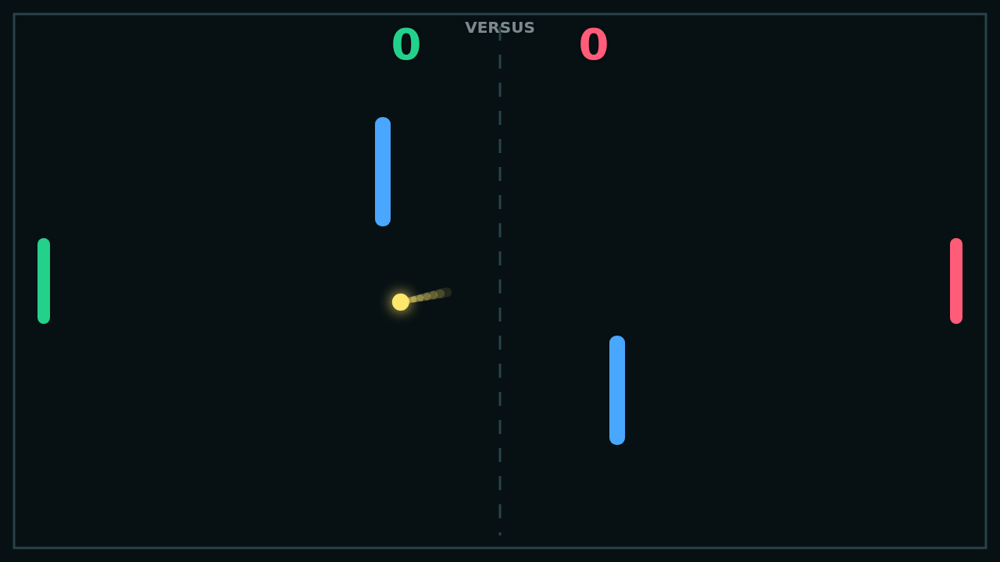

# Carom

Carom is a lean paddle duel about turning contact into control. Each serve opens
from center court, then the rally quickly becomes a fight over angle, timing, and
how much curve you can carry through the next rebound.

The paddles are simple, but they have bite: move through the ball at impact and
its path bends afterward. A flat return is safe, while a moving strike can arc
around a defender or pull the ball into a late wall kiss.

Two fixed obstacles split the middle of the field, making every exchange a small
bank-shot puzzle. The best points ricochet through the blue bars, skim a wall,
and arrive at the far paddle from somewhere awkward.

First to eleven with a two-point lead wins, whether you are playing Solo against
the right-side AI or sharing the keyboard in Versus.
